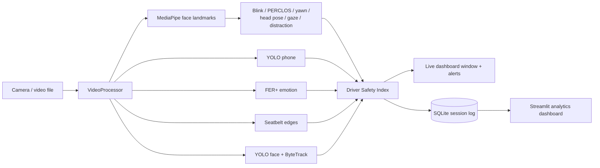

# Unified Driver Monitoring Dashboard

A research-oriented computer vision project for real-time in-cabin safety assessment using multiple AI models.

A single camera feed is analysed by several models at once. Their outputs are combined into a live **Driver Safety Index** with on-screen and audible alerts. Every session is logged, so it can be reviewed later in an **analytics dashboard**.

## Features

| Feature | How it works |
|---|---|
| Face Detection | YOLOv8n face model with ByteTrack IDs. The box containing the analysed face is marked as the driver. |
| Eye Tracking | MediaPipe iris landmarks give the eye's rotation in the head. Adding head yaw gives the real gaze direction (LEFT / CENTER / RIGHT). |
| Drowsiness Detection | Eye aspect ratio (EAR) drives blink counting, against a threshold learned from this driver rather than a constant (see [per-driver calibration](#per-driver-ear-calibration)). PERCLOS (share of the last minute with eyes closed) classifies the driver as AWAKE, TIRED (≥ 15%) or DROWSY (≥ 25%). Eyes closed for 1.5 s counts as a microsleep. |
| Yawning Detection | Mouth aspect ratio (MAR) held open for 0.8 s. Three yawns within 5 minutes counts as frequent yawning. |
| Head Pose Estimation | `solvePnP` on six landmarks gives yaw, pitch and roll. The neutral pose is calibrated over the first 3 s. Gaze off the road for 2 s counts as a distraction. |
| Phone Detection | COCO-trained YOLOv8n, "cell phone" class. Counts as in use once seen for 0.5 s. |
| Seatbelt Detection | Classical CV baseline: two parallel diagonal strap edges crossing the chest's centre line (Canny + Hough). See [limitations](#known-limitations). |
| Emotion Recognition | FER+ (ONNX) on the driver's face, 8 emotions, smoothed over time. Angry, sad, fearful and disgusted are flagged. |
| Driver Safety Index | Each active risk takes points off 100. The result maps to SAFE (≥ 75), CAUTION (≥ 50) or DANGER, with alerts and events. What a risk costs is not fixed — see [dynamic weighting](#dynamic-risk-weighting). |
| Analytics Dashboard | Each session is saved to SQLite and explored in a Streamlit dashboard. |

## How it fits together



Every threshold is in [`app/config.py`](app/config.py), with a comment explaining it. Durations are in seconds rather than frames, so behaviour does not change with frame rate.

## Per-driver EAR calibration

A fixed EAR threshold assumes an eye shape. Eye aperture varies enough between people that one constant cannot serve everybody: a driver whose open-eye EAR sits below the threshold is read as **permanently closed**, so PERCLOS pegs at 1.0 and the microsleep alert never stops, while a driver well above it may never cross it even on a real blink.

So the threshold is learned instead. Over the first 10 s the detector collects EAR samples and takes the driver's open eye as the 85th percentile and their closed eye as the 5th, then places the threshold at `closed + 0.4 × (open − closed)`. Percentiles rather than extremes, so one noisy frame cannot set the baseline. If no clear closure appears in the window it falls back to `0.75 × open`, which still removes the per-driver offset; if the result is implausible it is clamped to `[0.12, 0.32]` and the eye measurements are trusted less from then on.

The baseline is **frozen** once learned. A continuously adapting one would drift down with a driver whose eyes slowly narrow over a long drive, normalising away the drowsiness it exists to detect. Press **C** to calibrate again.

## Dynamic risk weighting

A condition's entry in `RISK_PENALTIES` is what it costs at its worst. Three layers scale that, every frame:

```
penalty = base × severity × confidence × context
```

| Layer | Question | Range | Driven by |
|---|---|---|---|
| severity | How bad is *this instance*? | 0.4 – 1.0 | how long the eyes were shut, how long the gaze was away, how deep PERCLOS went |
| confidence | How far can the detector be trusted? | 0.3 – 1.0 | YOLO box confidence, how near the seatbelt verdict sits to its boundary, how well the EAR calibrated, how much light there is |
| context | How much does the situation amplify it? | 1.0 – 1.75 | time of day, time at the wheel, cabin brightness |

Severity and confidence can only ever **reduce** a penalty; context can only ever **raise** one. Context applies to the fatigue conditions (clock and time at the wheel) and the attention conditions (light), and to nothing else.

The two halves deliberately pull against each other at night. Risk rises in the small hours, but a dark cabin is also where the eye measurements are worst, so the circadian multiplier raises the weight while the confidence layer lowers it:

```
drowsy, 3am, well lit    30 × 1.00 × 1.00 × 1.40  =  42.0
drowsy, 3am, dark cabin  30 × 1.00 × 0.55 × 1.40  =  23.1   (less than the 30 it costs at noon)
```

Without the second half the system would amplify its own noise at exactly the hour false alarms do the most damage.

The panel shows `DYNAMIC` or `STATIC` beside the FPS, and a `CONTEXT ×1.40 night dark` line under the score whenever something is amplifying. `--static-weights` runs the flat table instead, so one recording can be put through both.

## Setup

Tested on Windows 11 with Python 3.12.

```bash
python -m venv venv
venv\Scripts\activate
pip install -r requirements.txt
python download_models.py
```

`download_models.py` fetches the four model files into `trained_models/`, which is gitignored. It skips files that are already present.

## Running

Live monitoring with the webcam:

```bash
python -m app.main
```

Run it as a module from the project root. `python app/main.py` will not find the project's packages.

| Option | Meaning |
|---|---|
| `--source 1` | Use another webcam |
| `--source drive.mp4` | Analyse a video file. Video timestamps are used, so durations stay correct. |
| `--mute` | Start with alert sounds off |
| `--no-log` | Do not save this session |
| `--db path.db` | Save sessions to another database (default `data/driver_monitoring.db`) |
| `--static-weights` | Score with the flat penalty table, for comparison |
| `--hour 3` | Pretend it is this hour, to demonstrate the circadian weighting |
| `--weather rain` | Driving conditions. Not sensed — an in-cabin camera cannot see the road |
| `--speed 80` | Vehicle speed in km/h. Not sensed — needs an OBD-II link |

Keys: **Q**/**Esc** quit, **L** toggle landmarks, **C** recalibrate head pose, **S** toggle sound.

### Analytics dashboard

```bash
streamlit run dashboard/dashboard.py
```

The dashboard has these sections:
- Session picker
- Headline numbers: duration, average and lowest safety index, time in danger, blinks, yawns, microsleeps, distractions, phone uses
- Safety index over time
- Time at each risk level
- Eye, PERCLOS and mouth trends
- Head pose
- Emotion share
- Event log
- Raw measurements table, with CSV download

### Measuring accuracy

The monitor can say what it detected, but not whether it was right. To measure that, record a drive, write down what actually happened, and let the harness compare:

```bash
python -m evaluation.evaluate --video drive.mp4 --labels drive.csv
```

Ground truth is plain CSV, typed while scrubbing through the footage. Times are seconds from the start of the video; point events need only a start, episodes need both ends:

```csv
start,end,label
12.3,,blink
20.0,26.5,distracted
40.2,48.0,phone
```

Valid labels are `blink`, `yawn`, `microsleep`, `distracted`, `phone` and `no_seatbelt`. The report gives precision, recall and F1 for each: blinks and yawns are paired with their labels inside a ±0.5 s tolerance, while episodes are scored on how much of the time the two agree.

The same pass also runs **both** scoring engines over the identical frames and compares them, so neither can be accused of having had the easier video. Leave `--labels` off to get just that comparison and a summary of what was detected.

### Tests

```bash
python -m unittest discover -s tests -t .
```

There are 215 tests. Each analyser is tested on synthetic landmarks with known geometry, including head pose sign conventions, PERCLOS windows and microsleep episodes. Seatbelt tests use synthetic straps painted onto real photos. The safety index, the database and the dashboard (run headless with Streamlit's `AppTest`) are covered too. An end-to-end test runs the real models on a sample photo that ships with ultralytics.

## Demo guide

1. Sit about an arm's length from the camera, so your head and upper chest are in view.
2. Look straight ahead for the first 3 seconds while the banner says **CALIBRATING**. Press **C** to redo it.
3. Try each feature:

| Do this | You should see |
|---|---|
| Blink normally | BLINKS counts up, with the rate per minute |
| Look left or right with your eyes only | GAZE changes, and the gaze arrow from between your eyes follows. |
| Turn your head away for more than 2 s | ATTENTION: OFF ROAD, then DISTRACTED, plus the EYES OFF ROAD alert |
| Close your eyes for 2 s | DROWSINESS: MICROSLEEP, a flashing red banner and a beep |
| Yawn: open your mouth wide for about 1 s, then close it | YAWNS counts up when the mouth closes |
| Hold up a phone | Phone box, then PHONE: IN USE and an alert |
| Smile, or frown angrily | EMOTION changes |
| Put a diagonal strap (a seatbelt, or a bag strap) across your chest | SEATBELT: ON |
| Step out of view for 2 s | DRIVER NOT VISIBLE |

Watch the **SAFETY INDEX** at the top of the panel react to each of these. Afterwards, open the analytics dashboard to show the recorded session.

## Models

| File | Purpose | Source |
|---|---|---|
| `face/face_yolov8n.pt` | Face detection | Hugging Face `Bingsu/adetailer` |
| `face/face_landmarker.task` | 478 face landmarks, including irises | Google MediaPipe |
| `objects/yolov8n.pt` | Phone detection (COCO) | Ultralytics releases |
| `emotion/emotion-ferplus-8.onnx` | Facial expression (FER+) | ONNX Model Zoo |

## Known limitations

These are things to refine after the mid-implementation review:

- **The seatbelt detector is a heuristic baseline.** It finds strap-shaped diagonal bands, so a lanyard or a bag strap also reads as a belt. With less than about one face-height of chest in view, it reports UNKNOWN instead of guessing. A YOLO model trained on a labelled in-cabin dataset is the planned replacement.
- **Left and right assume an unmirrored camera image**, which is what OpenCV delivers on Windows.
- **MediaPipe needs a mostly frontal face.** Near-profile faces are detected by YOLO but not analysed. Small or distant faces are retried on a crop around the YOLO box.
- **Looking down lowers the eyelids**, which can raise PERCLOS slightly.
- **Everything runs on the CPU.** It measures about 18 FPS on the development laptop (Core i5-13420H). Phone, emotion and seatbelt detection take turns across a group of six frames, so half the frames run the landmarks alone. Spacing them 3 apart, as they were, put one heavy model on *every* frame and no frame was ever cheap; widening to 6 measured 12.6 → 18.4 FPS. FER+ is the most expensive model in the pipeline by some way (~67 ms against ~16 ms for the landmarks) while carrying the smallest penalty.
- **Blink recall is limited by the frame rate.** A blink lasts 100–200 ms, so at 18 FPS it spans two or three frames and a short one can still be missed. Run `evaluation/evaluate.py` against a hand-labelled video to measure how many.
- **Weather and speed are not sensed.** They are carried through `DrivingContext` and settable by hand, but an in-cabin camera cannot see the road and there is no vehicle bus to read, so nothing sets them automatically.
- **The weighting constants are a documented policy, not a fitted model.** The circadian shape follows published work on when fatigue crashes happen, but the specific multipliers are reasoned settings in `app/config.py`, not values learned from data.

## Project structure

```
app/            entry point, camera, configuration, per-frame pipeline
models/         model wrappers: YOLO face & objects, MediaPipe, FER+, seatbelt
analytics/      blink, drowsiness, yawn, head pose, gaze, distraction,
                phone usage, emotion smoothing, seatbelt pooling,
                per-driver EAR calibration
risk_engine/    Driver Safety Index, severity/confidence weights,
                driving context
renderers/      live window: overlays on the frame and the side panel
database/       SQLite session storage and logger
dashboard/      Streamlit analytics dashboard
evaluation/     accuracy against hand-written ground truth
utils/          alert sound, window sizing
tests/          unit and end-to-end tests
```
