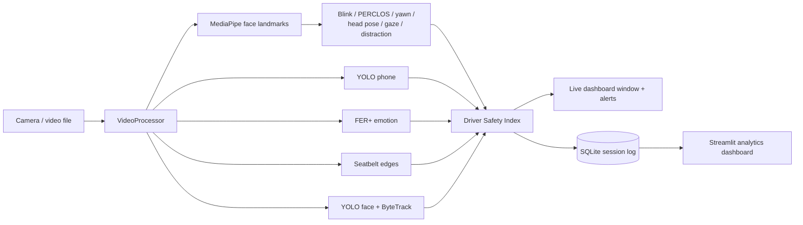

# Unified Driver Monitoring Dashboard

A research-oriented computer vision project for real-time in-cabin safety assessment using multiple AI models.

A single camera feed is analysed by several models at once. Their outputs are combined into a live **Driver Safety Index** with on-screen and audible alerts. Every session is logged, so it can be reviewed later in an **analytics dashboard**.

## Features

| Feature | How it works |
|---|---|
| Face Detection | YOLOv8n face model with ByteTrack IDs. The box containing the analysed face is marked as the driver. |
| Eye Tracking | MediaPipe iris landmarks give the eye's rotation in the head. Adding head yaw gives the real gaze direction (LEFT / CENTER / RIGHT). |
| Drowsiness Detection | Eye aspect ratio (EAR) drives blink counting, against a threshold learned from this driver rather than a constant (see [per-driver calibration](#per-driver-ear-calibration)). PERCLOS (share of the last minute with eyes closed) classifies the driver as AWAKE, TIRED (≥ 15%) or DROWSY (≥ 25%). Eyes closed for 1.5 s counts as a microsleep. |
| Yawning Detection | Mouth aspect ratio (MAR) held open for 0.8 s. Three yawns within 5 minutes counts as frequent yawning. |
| Head Pose Estimation | `solvePnP` on six landmarks gives yaw, pitch and roll. The neutral pose is calibrated over the first 3 s. Gaze off the road for 2 s counts as a distraction. |
| Phone Detection | COCO-trained YOLOv8n, "cell phone" class. Counts as in use once seen for 0.5 s. |
| Seatbelt Detection | Classical CV baseline: two parallel diagonal strap edges crossing the chest's centre line (Canny + Hough). See [limitations](#known-limitations). |
| Emotion Recognition | FER+ (ONNX) on the driver's face, 8 emotions, smoothed over time. Angry, sad, fearful and disgusted are flagged. |
| Weather Context | The current conditions, fetched from Open-Meteo for configured coordinates, raise what a lapse costs. The driver overrules it with **W**, and the source of every reading is logged — see [where the weather comes from](#where-the-weather-comes-from). |
| Camera Obstruction | A lens that is covered goes dark *and* flat. Both held for 2 s raises CAMERA BLOCKED instead of DRIVER NOT VISIBLE — see [seeing in the dark](#seeing-in-the-dark). |
| Low-Light Enhancement | Dim frames get CLAHE on the luma channel before detection, ramped by how dim they are. Not night vision — see [limitations](#known-limitations). |
| Alert Sounds | Two pulsed, rising patterns. The fatigue conditions get a longer, higher-climbing alarm than everything else, because a drowsy driver has to be roused rather than informed — see [alert sounds](#alert-sounds). |
| Driver Safety Index | Each active risk takes points off 100. The result maps to SAFE (≥ 75), CAUTION (≥ 50) or DANGER, with alerts and events. What a risk costs is not fixed — see [dynamic weighting](#dynamic-risk-weighting). |
| Analytics Dashboard | Each session is saved to SQLite and explored in a Streamlit dashboard. |

## How it fits together



Every threshold is in [`app/config.py`](app/config.py), with a comment explaining it. Durations are in seconds rather than frames, so behaviour does not change with frame rate.

## Per-driver EAR calibration

A fixed EAR threshold assumes an eye shape. Eye aperture varies enough between people that one constant cannot serve everybody: a driver whose open-eye EAR sits below the threshold is read as **permanently closed**, so PERCLOS pegs at 1.0 and the microsleep alert never stops, while a driver well above it may never cross it even on a real blink.

So the threshold is learned instead. Over the first 10 s the detector collects EAR samples and takes the driver's open eye as the 85th percentile and their closed eye as the 5th, then places the threshold at `closed + 0.4 × (open − closed)`. Percentiles rather than extremes, so one noisy frame cannot set the baseline. If no clear closure appears in the window it falls back to `0.75 × open`, which still removes the per-driver offset; if the result is implausible it is clamped to `[0.12, 0.32]` and the eye measurements are trusted less from then on.

The baseline is **frozen** once learned. A continuously adapting one would drift down with a driver whose eyes slowly narrow over a long drive, normalising away the drowsiness it exists to detect. Press **C** to calibrate again.

## Dynamic risk weighting

A condition's entry in `RISK_PENALTIES` is what it costs at its worst. Three layers scale that, every frame:

```
penalty = base × severity × confidence × context
```

| Layer | Question | Range | Driven by |
|---|---|---|---|
| severity | How bad is *this instance*? | 0.4 – 1.0 | how long the eyes were shut, how long the gaze was away, how deep PERCLOS went |
| confidence | How far can the detector be trusted? | 0.3 – 1.0 | YOLO box confidence, how near the seatbelt verdict sits to its boundary, how well the EAR calibrated, how much light there is |
| context | How much does the situation amplify it? | 1.0 – 2.36 | time of day, time at the wheel, cabin brightness, weather |

Severity and confidence can only ever **reduce** a penalty; context can only ever **raise** one. Context applies to the fatigue conditions and the attention conditions, and to nothing else — a missing seatbelt costs the same at 3am in a blizzard as at noon.

### What the context layer is weighing

The first three inputs are about **likelihood**: at 3am, after two hours at the wheel, a drowsiness detection is more likely to be real. Weather is different — rain does not make a driver sleepier or more easily distracted. It is about **consequence**: a wet road lengthens the stopping distance and poor visibility shortens the warning, so the same two-second glance away leaves less room to recover from. That argument applies just as well to a microsleep, which is why weather is the one input that amplifies *both* families rather than one.

| Weather | × | Why |
|---|---|---|
| clear, cloudy | 1.00 | full grip, full visibility |
| rain | 1.15 | wet grip, some visibility lost |
| heavy rain | 1.25 | wet grip, much less visibility |
| fog | 1.25 | dry grip, almost no visibility |
| snow | 1.30 | poor grip *and* poor visibility |
| ice | 1.35 | the worst grip of all |

Anything not in that table weighs 1.00, so an unrecognised condition cannot quietly inflate the score. The table is in `app/config.py` if you want to extend it.

### Where the weather comes from

A multiplier is only as good as its input, and this input has two possible sources that are *not* equally good evidence. So the system records which one it used.

**The forecast is the default.** Set `WEATHER_LATITUDE` and `WEATHER_LONGITUDE` in `app/config.py` (or pass `--latitude` / `--longitude`) and the app fetches the current conditions from [Open-Meteo](https://open-meteo.com) — free, no API key. The WMO code it returns is mapped onto the seven conditions above, with two refinements the code alone misses:

- **Rain at or below freezing becomes `ice`.** Liquid water landing on sub-zero tarmac is the black-ice case, and a forecast that just says "rain" at −1 °C hides it. Snow is deliberately exempt: it lands already frozen, and fresh snow grips better than a freezing-rain glaze.
- **Visibility under 1 km becomes at least `fog`**, however clear the sky is reported to be.

Both refinements only ever pick the *worse* of the two readings, so they can raise a condition and never lower one.

**The driver always wins.** Press **W** in the live window to step through the conditions and back to the forecast. The forecast answers for a *point*, at city resolution, up to 15 minutes old, and says nothing whatsoever about the road surface — rain five kilometres away reads as rain here. The person behind the wheel can see out of the window; the API cannot.

**Provenance is recorded, not just the value.** The panel shows a `WEATHER` row with the condition and its source, and both go into the session log as `weather` and `weather_source`:

| Source | Means |
|---|---|
| `forecast` | fetched and fresh |
| `forecast (stale)` | fetched earlier, refresh now failing — last good reading kept |
| `forecast (waiting)` | configured, first fetch not back yet |
| `forecast (offline)` | configured, never got a reading |
| `driver` | declared by `--weather` or the **W** key |
| `default` | no forecast configured and nobody said |

The last four all weigh 1.00, and that is the point of logging the source: **an honest 1.00 from a clear sky and an ignorant 1.00 from a dead network look identical in the score.** Only the provenance tells them apart, which is also why the `WEATHER` row stays on screen when the forecast is involved even if it reports clear — a driver who cannot see that the forecast is stale has no way of knowing there is anything to overrule.

The fetch runs on a daemon thread and the frame loop only ever reads a cached value, so a slow or dead network costs no frames. Nothing is fetched at all while the coordinates are unset.

The two halves deliberately pull against each other at night. Risk rises in the small hours, but a dark cabin is also where the eye measurements are worst, so the circadian multiplier raises the weight while the confidence layer lowers it:

```
drowsy, 3am, well lit    30 × 1.00 × 1.00 × 1.40  =  42.0
drowsy, 3am, dark cabin  30 × 1.00 × 0.55 × 1.40  =  23.1   (less than the 30 it costs at noon)
```

Without the second half the system would amplify its own noise at exactly the hour false alarms do the most damage.

The panel shows `DYNAMIC` or `STATIC` beside the FPS, and a line under the score naming whatever is amplifying — `CONTEXT ×1.40 night dark`, or `CONTEXT ×2.01 night 2.0h rain`. `--static-weights` runs the flat table instead, so one recording can be put through both.

One honest limit of the budget: `microsleep` costs 60 points at full severity, and the fatigue ceiling already takes that past 100 without any weather at all, so the score is clipped and `--weather ice` changes nothing visible for a microsleep. Weather is observable where there is headroom left — `tired`, `drowsy`, `distracted` and `phone`.

## Seeing in the dark

Two separate problems live at the bottom of the brightness scale, and the system handles them differently.

**A covered lens is not an empty seat.** Both leave the pipeline with no face, and both used to produce DRIVER NOT VISIBLE. They call for different responses: an empty seat is the driver gone, a covered lens is the monitor defeated — a tamper event in a fleet, and simply a closed privacy shutter on a laptop. Brightness alone cannot separate them, because a dark cabin is dark too. Variance can: a dark cabin still has shapes, highlights and sensor noise, so its pixels differ from each other, while a covered lens is flat. Mean ≤ 15 **and** standard deviation ≤ 8, both held for 2 s, raises CAMERA BLOCKED, which then suppresses DRIVER NOT VISIBLE so one cause gives one alert. Requiring the pair to hold for two seconds keeps a camera that is still waking up from being accused.

**A dim cabin is worth enhancing; a dark one is not.** Frames below a mean of 70 get CLAHE applied to the LAB luma channel, at a strength that ramps with how dim the frame is rather than switching on at a threshold — a frame hovering at the boundary would otherwise flicker between enhanced and raw, and the detectors with it. Colour survives, because the phone and emotion models want it.

Enhancement deliberately does **not** change the brightness the risk engine reads. Making an image easier to look at does not make the measurement more trustworthy, so the confidence layer keeps seeing the real light level and keeps discounting eye measurements accordingly. `--no-enhance` turns it off; running the same recording through the harness twice, with and without, is how to find out what it is worth on your camera.

## Setup

Tested on Windows 11 with Python 3.12.

```bash
python -m venv venv
venv\Scripts\activate
pip install -r requirements.txt
python download_models.py
```

`download_models.py` fetches the four model files into `trained_models/`, which is gitignored. It skips files that are already present.

## Running

Live monitoring with the webcam:

```bash
python -m app.main
```

Run it as a module from the project root. `python app/main.py` will not find the project's packages.

| Option | Meaning |
|---|---|
| `--source 1` | Use another webcam |
| `--source drive.mp4` | Analyse a video file. Video timestamps are used, so durations stay correct. |
| `--mute` | Start with alert sounds off |
| `--no-log` | Do not save this session |
| `--db path.db` | Save sessions to another database (default `data/driver_monitoring.db`) |
| `--static-weights` | Score with the flat penalty table, for comparison |
| `--hour 3` | Pretend it is this hour, to demonstrate the circadian weighting |
| `--weather rain` | Declare the conditions, overruling the forecast for the session. One of `clear`, `cloudy`, `rain`, `heavy_rain`, `fog`, `snow`, `ice`. Leave it off to let the forecast speak |
| `--latitude 28.6 --longitude 77.2` | Fetch the weather for this point. Without both, no forecast is fetched and nothing leaves the machine |
| `--no-forecast` | Never fetch the weather, even with coordinates set |
| `--speed 80` | Vehicle speed in km/h. Not sensed — needs an OBD-II link |
| `--no-enhance` | Do not lift dim frames before detection |

Keys: **Q**/**Esc** quit, **L** toggle landmarks, **C** recalibrate head pose, **S** toggle sound, **W** step the weather on (each condition in turn, then back to the forecast).

### Alert sounds

Two patterns, chosen by *what* is wrong rather than by severity alone.

| Pattern | Plays for | Shape | Length |
|---|---|---|---|
| **Rouse** | the fatigue conditions — microsleep, drowsiness | 1200 → 1600 → 2100 Hz, pulsed, said twice, ending on a long note | ~2.0 s, repeating every 3 s |
| **Notify** | everything else high or critical — phone, distraction, blocked camera, driver absent | 900 → 1200 Hz, two pulses | ~0.5 s, repeating every 4 s |

The split matters because `drowsy` and `phone` are both *high* severity, so they previously shared one 300 ms beep. They do not call for the same thing: a phone reminder only has to be *noticed*, while a fatigue alert has to reach someone whose eyes are already closing. When both are active, fatigue wins — it is the one the driver cannot simply decide to stop doing.

A single steady tone is the easy thing to tune out and the easy thing to sleep through, so both patterns pulse and rise; interruption and rising pitch are what read as urgent. The cooldowns are measured from the *start* of a pattern and each outlasts its own sound, so the silence in between survives — an alarm with no gaps just becomes background. **S** cuts a pattern short rather than waiting for it to finish, though it stops at the end of the current tone (up to ~0.5 s) because `winsound.Beep` cannot be interrupted mid-note.

Tones and cooldowns are in `app/config.py`. Windows only — elsewhere alerts stay visual.

### Analytics dashboard

```bash
streamlit run dashboard/dashboard.py
```

The dashboard has these sections:
- Session picker
- Headline numbers: duration, average and lowest safety index, time in danger, blinks, yawns, microsleeps, distractions, phone uses
- Safety index over time
- Time at each risk level
- Eye, PERCLOS and mouth trends
- Head pose
- Emotion share
- Risk weighting: the context multipliers over time, the cabin brightness, and which weather was in force **and on whose authority** — a session scored under declared snow reads `Weather: snow (driver)`, a fetched one `Weather: clear (forecast)`
- Event log
- Raw measurements table, with CSV download

### Measuring accuracy

The monitor can say what it detected, but not whether it was right. To measure that, record a drive, write down what actually happened, and let the harness compare:

```bash
python -m evaluation.evaluate --video drive.mp4 --labels drive.csv
```

Ground truth is plain CSV, typed while scrubbing through the footage. Times are seconds from the start of the video; point events need only a start, episodes need both ends:

```csv
start,end,label
12.3,,blink
20.0,26.5,distracted
40.2,48.0,phone
```

Valid labels are `blink`, `yawn`, `microsleep`, `distracted`, `phone` and `no_seatbelt`. The report gives precision, recall and F1 for each: blinks and yawns are paired with their labels inside a ±0.5 s tolerance, while episodes are scored on how much of the time the two agree.

The same pass also runs **both** scoring engines over the identical frames and compares them, so neither can be accused of having had the easier video. Leave `--labels` off to get just that comparison and a summary of what was detected.

`--no-enhance` is accepted here too, so a dim recording can be run twice and the low-light enhancement judged on recall rather than on how the frames look.

### Tests

```bash
python -m unittest discover -s tests -t .
```

There are 215 tests. Each analyser is tested on synthetic landmarks with known geometry, including head pose sign conventions, PERCLOS windows and microsleep episodes. Seatbelt tests use synthetic straps painted onto real photos. The safety index, the database and the dashboard (run headless with Streamlit's `AppTest`) are covered too. An end-to-end test runs the real models on a sample photo that ships with ultralytics.

## Demo guide

1. Sit about an arm's length from the camera, so your head and upper chest are in view.
2. Look straight ahead for the first 3 seconds while the banner says **CALIBRATING**. Press **C** to redo it.
3. Try each feature:

| Do this | You should see |
|---|---|
| Blink normally | BLINKS counts up, with the rate per minute |
| Look left or right with your eyes only | GAZE changes, and the gaze arrow from between your eyes follows. |
| Turn your head away for more than 2 s | ATTENTION: OFF ROAD, then DISTRACTED, plus the EYES OFF ROAD alert |
| Close your eyes for 2 s | DROWSINESS: MICROSLEEP, a flashing red banner and the two-second rising alarm |
| Yawn: open your mouth wide for about 1 s, then close it | YAWNS counts up when the mouth closes |
| Hold up a phone | Phone box, then PHONE: IN USE and an alert |
| Smile, or frown angrily | EMOTION changes |
| Put a diagonal strap (a seatbelt, or a bag strap) across your chest | SEATBELT: ON |
| Step out of view for 2 s | DRIVER NOT VISIBLE |
| Cover the lens with a finger for 2 s | CAMERA: BLOCKED and the CAMERA BLOCKED alert — *not* DRIVER NOT VISIBLE |
| Turn the room lights down | CAMERA: LOW LIGHT with the lift percentage, and the eye penalties quietly discounted |

4. Press **W** a few times. The `WEATHER` row steps through the conditions with its source changing from `forecast` to `driver`, and the `CONTEXT ×…` line under the score follows it. One more press hands control back to the forecast.
5. Restart with `--hour 3 --weather snow` and repeat the distraction and drowsiness steps, to show the context layer without waiting for 3am or for snow. The same lapse takes noticeably more off the score than it did at noon in the dry.

Watch the **SAFETY INDEX** at the top of the panel react to each of these. Afterwards, open the analytics dashboard to show the recorded session.

## Models

| File | Purpose | Source |
|---|---|---|
| `face/face_yolov8n.pt` | Face detection | Hugging Face `Bingsu/adetailer` |
| `face/face_landmarker.task` | 478 face landmarks, including irises | Google MediaPipe |
| `objects/yolov8n.pt` | Phone detection (COCO) | Ultralytics releases |
| `emotion/emotion-ferplus-8.onnx` | Facial expression (FER+) | ONNX Model Zoo |

## Known limitations

These are things to refine after the mid-implementation review:

- **The seatbelt detector is a heuristic baseline.** It finds strap-shaped diagonal bands, so a lanyard or a bag strap also reads as a belt. With less than about one face-height of chest in view, it reports UNKNOWN instead of guessing. A YOLO model trained on a labelled in-cabin dataset is the planned replacement.
- **Left and right assume an unmirrored camera image**, which is what OpenCV delivers on Windows.
- **MediaPipe needs a mostly frontal face.** Near-profile faces are detected by YOLO but not analysed. Small or distant faces are retried on a crop around the YOLO box.
- **Looking down lowers the eyelids**, which can raise PERCLOS slightly.
- **Everything runs on the CPU.** It measures about 18 FPS on the development laptop (Core i5-13420H). Phone, emotion and seatbelt detection take turns across a group of six frames, so half the frames run the landmarks alone. Spacing them 3 apart, as they were, put one heavy model on *every* frame and no frame was ever cheap; widening to 6 measured 12.6 → 18.4 FPS. FER+ is the most expensive model in the pipeline by some way (~67 ms against ~16 ms for the landmarks) while carrying the smallest penalty. In a dim cabin the low-light enhancement adds a measured ~10 ms to every frame, so expect roughly 15 FPS in the dark against 18 in good light; `--no-enhance` buys the frames back. Reading the brightness and variance costs ~0.3 ms and runs always.
- **Blink recall is limited by the frame rate.** A blink lasts 100–200 ms, so at 18 FPS it spans two or three frames and a short one can still be missed. Run `evaluation/evaluate.py` against a hand-labelled video to measure how many.
- **Low-light enhancement is not night vision and cannot become it.** Infrared needs an illuminator and a sensor without an IR-cut filter; a laptop webcam has neither, and no amount of processing recovers photons that were never captured. CLAHE redistributes the contrast that is already in the frame, which can bring a face in a *dim* room back within MediaPipe's reach. It does nothing for a cabin that is genuinely dark. A production in-cabin system uses an IR camera, and the confidence layer would then simply see a well-lit frame and stop discounting.
- **The obstruction thresholds are tuned to one laptop camera.** Mean ≤ 15 and standard deviation ≤ 8 separate a covered lens from a dark cabin on the development webcam. A sensor with a different noise floor — most obviously one that denoises aggressively in low light — may need `CAMERA_BLOCKED_VARIANCE` raised in `app/config.py`.
- **The weather is fetched for a point, not measured on the road.** A forecast is a better default than nothing, but it is city-resolution, up to 15 minutes old, and silent about the thing that actually matters — standing water and black ice are invisible to it. The driver's override is believed on their word and cannot be checked either. So the weather multiplier honestly reads "what the drive is *reported or claimed* to be like", never "what it is like". What keeps that from being a quiet fiction is that every reading carries its source into the log. The real fix is the vehicle itself: wiper state is the best weather proxy any car has, and ABS or traction-control activation is *measured* grip loss rather than a forecast of it — both on the same CAN bus that `speed` is waiting for.
- **A wrong declaration is bounded, not prevented.** Because context can only ever raise a penalty, a driver who declares `clear` to silence alerts lands back on the flat baseline — they cannot make the system more permissive than the static engine. The invariant limits the damage; it does not detect the lie.
- **Speed is carried but not weighed at all.** It reaches `DrivingContext` and stops there. Reading it needs an OBD-II link, and without one there is nothing to calibrate a speed multiplier against — a guessed number would look like evidence it isn't.
- **The weighting constants are a documented policy, not a fitted model.** The circadian shape follows published work on when fatigue crashes happen, and the weather ordering follows what grip and visibility each condition leaves, but the specific multipliers are reasoned settings in `app/config.py`, not values learned from data. The weather numbers in particular are much flatter than published crash-risk ratios (which put adverse weather at roughly 1.5–2× clear, and ice far higher) because they are penalty weights inside a 100-point budget, not crash odds — scaling them to the literature would saturate the score the moment it rained.

## Project structure

```
app/            entry point, camera, configuration, per-frame pipeline
models/         model wrappers: YOLO face & objects, MediaPipe, FER+, seatbelt
analytics/      blink, drowsiness, yawn, head pose, gaze, distraction,
                phone usage, emotion smoothing, seatbelt pooling,
                per-driver EAR calibration, camera obstruction
risk_engine/    Driver Safety Index, severity/confidence weights,
                driving context
renderers/      live window: overlays on the frame and the side panel
database/       SQLite session storage and logger
dashboard/      Streamlit analytics dashboard
evaluation/     accuracy against hand-written ground truth
utils/          alert sound, window sizing, low-light enhancement,
                weather forecast client
tests/          unit and end-to-end tests
```
