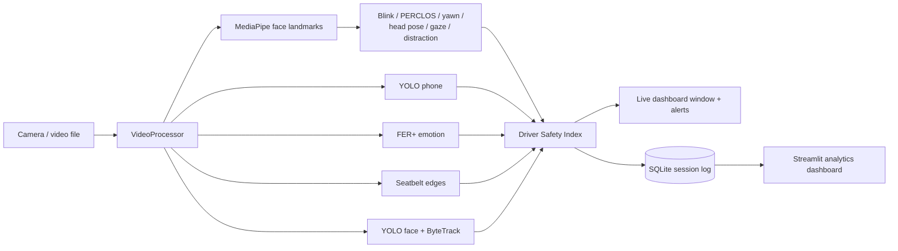

# Unified Driver Monitoring Dashboard

A research-oriented computer vision project for real-time in-cabin safety assessment using multiple AI models.

A single camera feed is analysed by several models at once. Their outputs are combined into a live **Driver Safety Index** with on-screen and audible alerts. Every session is logged, so it can be reviewed later in an **analytics dashboard**.

## Features

| Feature | How it works |
|---|---|
| Face Detection | YOLOv8n face model with ByteTrack IDs. The box containing the analysed face is marked as the driver. |
| Eye Tracking | MediaPipe iris landmarks give the eye's rotation in the head. Adding head yaw gives the real gaze direction (LEFT / CENTER / RIGHT). |
| Drowsiness Detection | Eye aspect ratio (EAR) drives blink counting. PERCLOS (share of the last minute with eyes closed) classifies the driver as AWAKE, TIRED (≥ 15%) or DROWSY (≥ 25%). Eyes closed for 1.5 s counts as a microsleep. |
| Yawning Detection | Mouth aspect ratio (MAR) held open for 0.8 s. Three yawns within 5 minutes counts as frequent yawning. |
| Head Pose Estimation | `solvePnP` on six landmarks gives yaw, pitch and roll. The neutral pose is calibrated over the first 3 s. Gaze off the road for 2 s counts as a distraction. |
| Phone Detection | COCO-trained YOLOv8n, "cell phone" class. Counts as in use once seen for 0.5 s. |
| Seatbelt Detection | Classical CV baseline: two parallel diagonal strap edges crossing the chest's centre line (Canny + Hough). See [limitations](#known-limitations). |
| Emotion Recognition | FER+ (ONNX) on the driver's face, 8 emotions, smoothed over time. Angry, sad, fearful and disgusted are flagged. |
| Driver Safety Index | Each active risk takes points off 100. The result maps to SAFE (≥ 75), CAUTION (≥ 50) or DANGER, with alerts and events. |
| Analytics Dashboard | Each session is saved to SQLite and explored in a Streamlit dashboard. |

## How it fits together



Every threshold is in [`app/config.py`](app/config.py), with a comment explaining it. Durations are in seconds rather than frames, so behaviour does not change with frame rate.

## Setup

Tested on Windows 11 with Python 3.12.

```bash
python -m venv venv
venv\Scripts\activate
pip install -r requirements.txt
python download_models.py
```

`download_models.py` fetches the four model files into `trained_models/`, which is gitignored. It skips files that are already present.

## Running

Live monitoring with the webcam:

```bash
python -m app.main
```

Run it as a module from the project root. `python app/main.py` will not find the project's packages.

| Option | Meaning |
|---|---|
| `--source 1` | Use another webcam |
| `--source drive.mp4` | Analyse a video file. Video timestamps are used, so durations stay correct. |
| `--mute` | Start with alert sounds off |
| `--no-log` | Do not save this session |
| `--db path.db` | Save sessions to another database (default `data/driver_monitoring.db`) |

Keys: **Q**/**Esc** quit, **L** toggle landmarks, **C** recalibrate head pose, **S** toggle sound.

### Analytics dashboard

```bash
streamlit run dashboard/dashboard.py
```

The dashboard has these sections:
- Session picker
- Headline numbers: duration, average and lowest safety index, time in danger, blinks, yawns, microsleeps, distractions, phone uses
- Safety index over time
- Time at each risk level
- Eye, PERCLOS and mouth trends
- Head pose
- Emotion share
- Event log
- Raw measurements table, with CSV download

### Tests

```bash
python -m unittest discover -s tests -t .
```

There are 110 tests. Each analyser is tested on synthetic landmarks with known geometry, including head pose sign conventions, PERCLOS windows and microsleep episodes. Seatbelt tests use synthetic straps painted onto real photos. The safety index, the database and the dashboard (run headless with Streamlit's `AppTest`) are covered too. An end-to-end test runs the real models on a sample photo that ships with ultralytics.

## Demo guide

1. Sit about an arm's length from the camera, so your head and upper chest are in view.
2. Look straight ahead for the first 3 seconds while the banner says **CALIBRATING**. Press **C** to redo it.
3. Try each feature:

| Do this | You should see |
|---|---|
| Blink normally | BLINKS counts up, with the rate per minute |
| Look left or right with your eyes only | GAZE changes, and the gaze arrow from between your eyes follows. |
| Turn your head away for more than 2 s | ATTENTION: OFF ROAD, then DISTRACTED, plus the EYES OFF ROAD alert |
| Close your eyes for 2 s | DROWSINESS: MICROSLEEP, a flashing red banner and a beep |
| Yawn: open your mouth wide for about 1 s, then close it | YAWNS counts up when the mouth closes |
| Hold up a phone | Phone box, then PHONE: IN USE and an alert |
| Smile, or frown angrily | EMOTION changes |
| Put a diagonal strap (a seatbelt, or a bag strap) across your chest | SEATBELT: ON |
| Step out of view for 2 s | DRIVER NOT VISIBLE |

Watch the **SAFETY INDEX** at the top of the panel react to each of these. Afterwards, open the analytics dashboard to show the recorded session.

## Models

| File | Purpose | Source |
|---|---|---|
| `face/face_yolov8n.pt` | Face detection | Hugging Face `Bingsu/adetailer` |
| `face/face_landmarker.task` | 478 face landmarks, including irises | Google MediaPipe |
| `objects/yolov8n.pt` | Phone detection (COCO) | Ultralytics releases |
| `emotion/emotion-ferplus-8.onnx` | Facial expression (FER+) | ONNX Model Zoo |

## Known limitations

These are things to refine after the mid-implementation review:

- **The seatbelt detector is a heuristic baseline.** It finds strap-shaped diagonal bands, so a lanyard or a bag strap also reads as a belt. With less than about one face-height of chest in view, it reports UNKNOWN instead of guessing. A YOLO model trained on a labelled in-cabin dataset is the planned replacement.
- **Left and right assume an unmirrored camera image**, which is what OpenCV delivers on Windows.
- **MediaPipe needs a mostly frontal face.** Near-profile faces are detected by YOLO but not analysed. Small or distant faces are retried on a crop around the YOLO box.
- **Looking down lowers the eyelids**, which can raise PERCLOS slightly.
- **Everything runs on the CPU.** It measured about 10 FPS on the development laptop (Core i5-13420H) while another heavy program was running. Phone, emotion and seatbelt detection take turns on successive frames to spread the load.

## Project structure

```
app/            entry point, camera, configuration, per-frame pipeline
models/         model wrappers: YOLO face & objects, MediaPipe, FER+, seatbelt
analytics/      blink, drowsiness, yawn, head pose, gaze, distraction,
                phone usage, emotion smoothing, seatbelt pooling
risk_engine/    Driver Safety Index
renderers/      live window: overlays on the frame and the side panel
database/       SQLite session storage and logger
dashboard/      Streamlit analytics dashboard
utils/          alert sound, window sizing
tests/          unit and end-to-end tests
```
