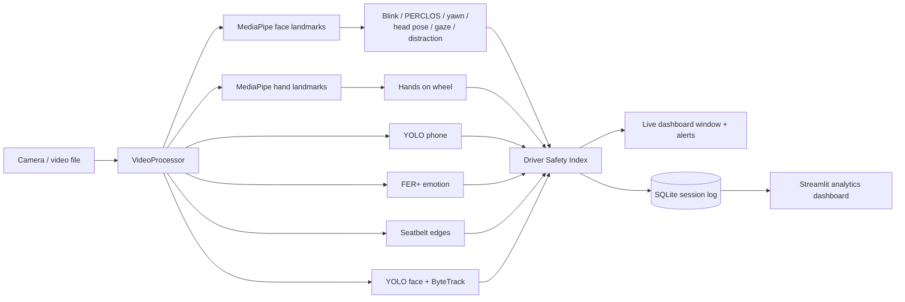

# Unified Driver Monitoring Dashboard

A research-oriented computer vision project for real-time in-cabin safety assessment using multiple AI models.

A single camera feed is analysed by several models at once. Their outputs are combined into a live **Driver Safety Index** with on-screen and audible alerts. Every session is logged, so it can be reviewed later in an **analytics dashboard**.

## Features

| Feature | How it works |
|---|---|
| Face Detection | YOLOv8n face model with ByteTrack IDs. The box containing the analysed face is marked as the driver. |
| Eye Tracking | MediaPipe iris landmarks give the eye's rotation in the head. Adding head yaw gives the real gaze direction (LEFT / CENTER / RIGHT). |
| Drowsiness Detection | Eye aspect ratio (EAR) drives blink counting, against a threshold learned from this driver rather than a constant (see [per-driver calibration](#per-driver-ear-calibration)). PERCLOS (share of the last minute with eyes closed) classifies the driver as AWAKE, TIRED (≥ 15%) or DROWSY (≥ 25%). Eyes closed for 1.5 s counts as a microsleep. |
| Yawning Detection | Mouth aspect ratio (MAR) held open for 0.8 s. Three yawns within 5 minutes counts as frequent yawning. |
| Head Pose Estimation | SQPnP on five landmarks gives yaw, pitch and roll. The neutral pose is calibrated over the first 3 s. Gaze off the road for 2 s counts as a distraction. |
| Phone Detection | COCO-trained YOLOv8n, "cell phone" class. Counts as in use once seen for 0.5 s. |
| Seatbelt Detection | Classical CV baseline: two parallel diagonal strap edges crossing the chest's centre line (Canny + Hough). See [limitations](#known-limitations). |
| Hands on the Wheel | MediaPipe hand landmarks, 21 points per hand. Both hands gone for 3 s raises HANDS OFF WHEEL — but only on a camera that has proved it can see hands at all, see [hands on the wheel](#hands-on-the-wheel). |
| Emotion Recognition | FER+ (ONNX) on the driver's face, 8 emotions, smoothed over time. Angry, sad, fearful and disgusted are flagged. |
| Weather Context | The current conditions, fetched from Open-Meteo for configured coordinates, raise what a lapse costs. The driver overrules it with **W**, and the source of every reading is logged — see [where the weather comes from](#where-the-weather-comes-from). |
| Camera Obstruction | A lens that is covered goes dark *and* flat. Both held for 2 s raises CAMERA BLOCKED instead of DRIVER NOT VISIBLE — see [seeing in the dark](#seeing-in-the-dark). |
| Low-Light Enhancement | Dim frames get CLAHE on the luma channel before detection, ramped by how dim they are. Not night vision — see [limitations](#known-limitations). |
| Alert Sounds | Two pulsed, rising patterns. The fatigue conditions get a longer, higher-climbing alarm than everything else, because a drowsy driver has to be roused rather than informed — see [alert sounds](#alert-sounds). |
| Driver Safety Index | Each active risk takes points off 100. The result maps to SAFE (≥ 75), CAUTION (≥ 50) or DANGER, with alerts and events. What a risk costs is not fixed — see [dynamic weighting](#dynamic-risk-weighting). |
| Analytics Dashboard | Each session is saved to SQLite and explored in a Streamlit dashboard. |

## How it fits together



Every threshold is in [`app/config.py`](app/config.py), with a comment explaining it. Durations are in seconds rather than frames, so behaviour does not change with frame rate.

## Per-driver EAR calibration

A fixed EAR threshold assumes an eye shape. Eye aperture varies enough between people that one constant cannot serve everybody: a driver whose open-eye EAR sits below the threshold is read as **permanently closed**, so PERCLOS pegs at 1.0 and the microsleep alert never stops, while a driver well above it may never cross it even on a real blink.

So the threshold is learned instead. Over the first 10 s the detector collects EAR samples and takes the driver's open eye as the 85th percentile and their closed eye as the 5th, then places the threshold at `closed + 0.4 × (open − closed)`. Percentiles rather than extremes, so one noisy frame cannot set the baseline. If no clear closure appears in the window it falls back to `0.75 × open`, which still removes the per-driver offset; if the result is implausible it is clamped to `[0.12, 0.32]` and the eye measurements are trusted less from then on.

The baseline is **frozen** once learned. A continuously adapting one would drift down with a driver whose eyes slowly narrow over a long drive, normalising away the drowsiness it exists to detect. Press **C** to calibrate again.

## Dynamic risk weighting

A condition's entry in `RISK_PENALTIES` is what it costs at its worst. Three layers scale that, every frame:

```
penalty = base × severity × confidence × context
```

| Layer | Question | Range | Driven by |
|---|---|---|---|
| severity | How bad is *this instance*? | 0.4 – 1.0 | how long the eyes were shut, how long the gaze was away, how deep PERCLOS went |
| confidence | How far can the detector be trusted? | 0.3 – 1.0 | YOLO box confidence, how near the seatbelt verdict sits to its boundary, how well the EAR calibrated, how much light there is |
| context | How much does the situation amplify it? | 1.0 – 2.36 | time of day, time at the wheel, cabin brightness, weather |

Severity and confidence can only ever **reduce** a penalty; context can only ever **raise** one. Context applies to the fatigue conditions and the attention conditions, and to nothing else — a missing seatbelt costs the same at 3am in a blizzard as at noon.

### What the context layer is weighing

The first three inputs are about **likelihood**: at 3am, after two hours at the wheel, a drowsiness detection is more likely to be real. Weather is different — rain does not make a driver sleepier or more easily distracted. It is about **consequence**: a wet road lengthens the stopping distance and poor visibility shortens the warning, so the same two-second glance away leaves less room to recover from. That argument applies just as well to a microsleep, which is why weather is the one input that amplifies *both* families rather than one.

| Weather | × | Why |
|---|---|---|
| clear, cloudy | 1.00 | full grip, full visibility |
| rain | 1.15 | wet grip, some visibility lost |
| heavy rain | 1.25 | wet grip, much less visibility |
| fog | 1.25 | dry grip, almost no visibility |
| snow | 1.30 | poor grip *and* poor visibility |
| ice | 1.35 | the worst grip of all |

Anything not in that table weighs 1.00, so an unrecognised condition cannot quietly inflate the score. The table is in `app/config.py` if you want to extend it.

### Where the weather comes from

A multiplier is only as good as its input, and this input has two possible sources that are *not* equally good evidence. So the system records which one it used.

**The forecast is the default.** Set `WEATHER_LATITUDE` and `WEATHER_LONGITUDE` in `app/config.py` (or pass `--latitude` / `--longitude`) and the app fetches the current conditions from [Open-Meteo](https://open-meteo.com) — free, no API key. The WMO code it returns is mapped onto the seven conditions above, with two refinements the code alone misses:

- **Rain at or below freezing becomes `ice`.** Liquid water landing on sub-zero tarmac is the black-ice case, and a forecast that just says "rain" at −1 °C hides it. Snow is deliberately exempt: it lands already frozen, and fresh snow grips better than a freezing-rain glaze.
- **Visibility under 1 km becomes at least `fog`**, however clear the sky is reported to be.

Both refinements only ever pick the *worse* of the two readings, so they can raise a condition and never lower one.

**The driver always wins.** Press **W** in the live window to step through the conditions and back to the forecast. The forecast answers for a *point*, at city resolution, up to 15 minutes old, and says nothing whatsoever about the road surface — rain five kilometres away reads as rain here. The person behind the wheel can see out of the window; the API cannot.

**Provenance is recorded, not just the value.** The panel shows a `WEATHER` row with the condition and its source, and both go into the session log as `weather` and `weather_source`:

| Source | Means |
|---|---|
| `forecast` | fetched and fresh |
| `forecast (stale)` | fetched earlier, refresh now failing — last good reading kept |
| `forecast (waiting)` | configured, first fetch not back yet |
| `forecast (offline)` | configured, never got a reading |
| `driver` | declared by `--weather` or the **W** key |
| `default` | no forecast configured and nobody said |

The last four all weigh 1.00, and that is the point of logging the source: **an honest 1.00 from a clear sky and an ignorant 1.00 from a dead network look identical in the score.** Only the provenance tells them apart, which is also why the `WEATHER` row stays on screen when the forecast is involved even if it reports clear — a driver who cannot see that the forecast is stale has no way of knowing there is anything to overrule.

The fetch runs on a daemon thread and the frame loop only ever reads a cached value, so a slow or dead network costs no frames. Nothing is fetched at all while the coordinates are unset.

The two halves deliberately pull against each other at night. Risk rises in the small hours, but a dark cabin is also where the eye measurements are worst, so the circadian multiplier raises the weight while the confidence layer lowers it:

```
drowsy, 3am, well lit    30 × 1.00 × 1.00 × 1.40  =  42.0
drowsy, 3am, dark cabin  30 × 1.00 × 0.55 × 1.40  =  23.1   (less than the 30 it costs at noon)
```

Without the second half the system would amplify its own noise at exactly the hour false alarms do the most damage.

The panel shows `DYNAMIC` or `STATIC` beside the FPS, and a line under the score naming whatever is amplifying — `CONTEXT ×1.40 night dark`, or `CONTEXT ×2.01 night 2.0h rain`. `--static-weights` runs the flat table instead, so one recording can be put through both.

One honest limit of the budget: `microsleep` costs 60 points at full severity, and the fatigue ceiling already takes that past 100 without any weather at all, so the score is clipped and `--weather ice` changes nothing visible for a microsleep. Weather is observable where there is headroom left — `tired`, `drowsy`, `distracted` and `phone`.

## Seeing in the dark

Two separate problems live at the bottom of the brightness scale, and the system handles them differently.

**A covered lens is not an empty seat.** Both leave the pipeline with no face, and both used to produce DRIVER NOT VISIBLE. They call for different responses: an empty seat is the driver gone, a covered lens is the monitor defeated — a tamper event in a fleet, and simply a closed privacy shutter on a laptop. Brightness alone cannot separate them, because a dark cabin is dark too. Variance can: a dark cabin still has shapes, highlights and sensor noise, so its pixels differ from each other, while a covered lens is flat. Mean ≤ 15 **and** standard deviation ≤ 8, both held for 2 s, raises CAMERA BLOCKED, which then suppresses DRIVER NOT VISIBLE so one cause gives one alert. Requiring the pair to hold for two seconds keeps a camera that is still waking up from being accused.

**A dark lens is only one of the ways a feed goes blind.** Covering the lens by hand on the test recording produced two thirds of a second of black and then a still graphic: Windows had noticed the obstruction and substituted its own picture, bright and full of detail. 200 consecutive frames, bit identical. Every brightness-and-variance check passed and the monitor reported nothing — the whole of a 0% recall on that cue. So a frozen feed is the second way in: consecutive frames identical **to the bit** never come from a live sensor, because noise alone guarantees a difference, so they mean the pipeline is being handed the same picture over and over. A second of them raises CAMERA BLOCKED with the reason `frozen` rather than `flat`, because a hand over the lens is fixed by moving the hand and a substituted graphic is not. The fingerprint is a hash of the sample already taken to measure the light, so the check costs nothing extra. That took `camera_blocked` from **0% recall to 77% at 100% precision**.

**A dim cabin is worth enhancing; a dark one is not.** Frames below a mean of 70 get CLAHE applied to the LAB luma channel, at a strength that ramps with how dim the frame is rather than switching on at a threshold — a frame hovering at the boundary would otherwise flicker between enhanced and raw, and the detectors with it. Colour survives, because the phone and emotion models want it.

Enhancement deliberately does **not** change the brightness the risk engine reads. Making an image easier to look at does not make the measurement more trustworthy, so the confidence layer keeps seeing the real light level and keeps discounting eye measurements accordingly. `--no-enhance` turns it off; running the same recording through the harness twice, with and without, is how to find out what it is worth on your camera.

## Hands on the wheel

MediaPipe's hand landmarker runs alongside the face landmarker, and both
hands gone for 3 s raises HANDS OFF WHEEL. One hand is reported but never
alarms: changing gear and indicating are one-handed and legal, and a
monitor that complained about them would be switched off within a minute.

**The hard part is not detecting hands, it is earning the right to
complain about their absence.** This camera is aimed at a face. On a
laptop on the dashboard, or any mount framed tightly on the driver's
head, the wheel is simply below the bottom edge — and then "no hands
found" is the normal state for the whole drive, not a lapse. A monitor
that read it as hands off the wheel would cry wolf from the first second
to the last, which is worse than saying nothing at all.

So the monitor has to see hands before their absence means anything,
and what it asks for is a **share**: hands found low in the frame in at
least **30% of the samples in the last 60 seconds**, with the window
given 30 seconds to fill first. Until then the status is UNKNOWN, the
panel reads `HANDS  --  wheel not in view`, and no alert can fire. This
mirrors what the seatbelt detector already does when too little chest is
in view: say UNKNOWN rather than guess.

A share, because the first version asked for a *count* — ten sightings
in the window — and a count turned out to be far cheaper to satisfy than
it looks. Hands are looked for on one frame in six, so ten sightings is
two seconds of one continuous sighting, and two seconds bought sixty
seconds of judgement. The harness found it: the driver held a phone up
beside their face, the monitor decided 1.7 s into that it could see the
wheel, and it then reported the next thirty seconds — hands resting in a
lap, below the frame — as hands off the wheel. **1520 frames reported
against 349 performed, 22.9% precision.** A share is the right shape for
the question, because a wheel that is in shot has hands on it nearly all
the time, while a wheel that is out of shot produces hands only in
passing.

Two details keep the share honest in both directions. **A hand is only
counted if it is below the driver's chin**, since a wheel is, and a hand
raised to the face is evidence of nothing — which also stops a hand
lifted off the wheel from reading as a hand on it and silencing a
genuine alarm. And **a proved view is given up only after a full minute
with no hands at all**, not merely when the share falls, because a share
falling is exactly what a long spell of hands off the wheel looks like
from in here: a monitor that read its own alarm as proof it could not see
would switch itself off the longer the violation ran. A full minute of
nothing is the different thing — a camera that has been moved, or one
that never had the wheel in frame — and after it the view has to be
earned again.

The consequence worth stating plainly is that **on a face-framed camera
this feature stays silent, by design.** It is not broken when the HANDS
row reads `--`; it is refusing to make a claim its view cannot support.
Point the camera so the wheel's top arc is in shot and it starts
judging. `HANDS_SEEN_SHARE`, `HANDS_SEEN_WARMUP` and `HANDS_SEEN_WINDOW`
in `app/config.py` set how much evidence it wants.

The status is logged every snapshot and summarised per session, so
a drive can be reviewed for it afterwards — including the UNKNOWN
case, which is recorded as a reading rather than left blank. A
reviewer who cannot tell "the wheel was out of shot" from "the
driver never let go" has been told nothing.

**A covered lens is treated as a wheel out of shot.** The monitor
cannot see, so the clock stops and the status drops to UNKNOWN until
the view comes back. This was not designed in; it was found by
pointing the harness at a clip whose lens was covered for eight
seconds and getting back a hands-off episode nobody had performed.
The alert was charging one cause twice -- the same mistake that
suppressing DRIVER NOT VISIBLE while blocked already avoids -- and
it cost a phantom 25 points for every blocked frame. Sightings are
left to expire on their own rather than cleared, so a hand passing
over the lens does not cost the monitor its right to judge.

`hands_off` costs 25 points, scaled by how long the hands have been
gone: 3 s is the floor and 10 s is the full penalty. It is an attention
condition, so the context layer applies — hands off the wheel on ice
costs more than hands off the wheel on a clear road.

## Setup

Tested on Windows 11 with Python 3.12.

```bash
python -m venv venv
venv\Scripts\activate
pip install -r requirements.txt
python download_models.py
```

`download_models.py` fetches the five model files into `trained_models/`, which is gitignored. It skips files that are already present.

## Running

Live monitoring with the webcam:

```bash
python -m app.main
```

Run it as a module from the project root. `python app/main.py` will not find the project's packages.

| Option | Meaning |
|---|---|
| `--source 1` | Use another webcam |
| `--source drive.mp4` | Analyse a video file. Video timestamps are used, so durations stay correct. |
| `--mute` | Start with alert sounds off |
| `--no-log` | Do not save this session |
| `--db path.db` | Save sessions to another database (default `data/driver_monitoring.db`) |
| `--static-weights` | Score with the flat penalty table, for comparison |
| `--hour 3` | Pretend it is this hour, to demonstrate the circadian weighting |
| `--weather rain` | Declare the conditions, overruling the forecast for the session. One of `clear`, `cloudy`, `rain`, `heavy_rain`, `fog`, `snow`, `ice`. Leave it off to let the forecast speak |
| `--latitude 28.6 --longitude 77.2` | Fetch the weather for this point. Without both, no forecast is fetched and nothing leaves the machine |
| `--no-forecast` | Never fetch the weather, even with coordinates set |
| `--speed 80` | Vehicle speed in km/h. Not sensed — needs an OBD-II link |
| `--no-enhance` | Do not lift dim frames before detection |

Keys: **Q**/**Esc** quit, **L** toggle landmarks, **C** recalibrate head pose, **S** toggle sound, **W** step the weather on (each condition in turn, then back to the forecast).

### Alert sounds

Two patterns, chosen by *what* is wrong rather than by severity alone.

| Pattern | Plays for | Shape | Length |
|---|---|---|---|
| **Rouse** | the fatigue conditions — microsleep, drowsiness | 1200 → 1600 → 2100 Hz, pulsed, said twice, ending on a long note | ~2.0 s, repeating every 3 s |
| **Notify** | everything else high or critical — phone, distraction, blocked camera, driver absent | 900 → 1200 Hz, two pulses | ~0.5 s, repeating every 4 s |

The split matters because `drowsy` and `phone` are both *high* severity, so they previously shared one 300 ms beep. They do not call for the same thing: a phone reminder only has to be *noticed*, while a fatigue alert has to reach someone whose eyes are already closing. When both are active, fatigue wins — it is the one the driver cannot simply decide to stop doing.

A single steady tone is the easy thing to tune out and the easy thing to sleep through, so both patterns pulse and rise; interruption and rising pitch are what read as urgent. The cooldowns are measured from the *start* of a pattern and each outlasts its own sound, so the silence in between survives — an alarm with no gaps just becomes background. **S** cuts a pattern short rather than waiting for it to finish, though it stops at the end of the current tone (up to ~0.5 s) because `winsound.Beep` cannot be interrupted mid-note.

Tones and cooldowns are in `app/config.py`. Windows only — elsewhere alerts stay visual.

### Analytics dashboard

```bash
streamlit run dashboard/dashboard.py
```

The dashboard has these sections:
- Session picker
- Headline numbers: duration, average and lowest safety index, time in danger, blinks, yawns, microsleeps, distractions, phone uses
- Safety index over time
- Time at each risk level
- Eye, PERCLOS and mouth trends
- Head pose
- Emotion share
- Risk weighting: the context multipliers over time, the cabin brightness, and which weather was in force **and on whose authority** — a session scored under declared snow reads `Weather: snow (driver)`, a fetched one `Weather: clear (forecast)`
- Camera and wheel: the share of the session each hands-on-wheel status held, how many hands-off episodes there were, and how much of the drive the lens was covered for. An unseen wheel says so in words, because a bare zero here would read as a flawless drive
- Event log
- Raw measurements table, with CSV download

### Measuring accuracy

The monitor can say what it detected, but not whether it was right. To measure that, record a drive, write down what actually happened, and let the harness compare:

```bash
python -m evaluation.evaluate --video drive.mp4 --labels drive.csv
```

#### Recording one

Writing ground truth by hand means scrubbing a video with a notepad, guessing at the frame a yawn ended. That is slow enough that it does not get done, which is why these detectors went unmeasured for so long. So the recording is scripted:

```bash
python -m evaluation.record_session --video drive.mp4 --labels drive.csv
```

**The cues are spoken as well as drawn.** Half the script asks you to stop watching the screen -- eyes closed, head turned away, a palm over the lens -- and during those a countdown in the corner may as well not be there. Windows can speak without any package installed, so a long-lived PowerShell reads each cue out, and a chime marks the change.

**Each cue is spoken before the step it belongs to**, timed to finish as that step begins. The first version read the cue out *at* the boundary and wrote the label from that same moment, so the label began while the instruction was still being read and the driver, reasonably, acted on the last word. Rendering the script's own sentences to audio puts them at 1.9 to 5.5 seconds each, which is the whole of the 2-to-4-second lag in the first recording — a quarter of a ten-second episode labelled against footage of the driver doing something else. The lead is computed from each sentence's length at a measured 13 characters a second, so long cues get more warning than short ones, and the unlabelled steps in between are eight seconds rather than six to leave room for it. If speech cannot start, or dies partway, the recording carries on silently rather than taking the session down; `--no-voice` turns it off.

It prompts you through about two minutes of cues — look away, hold a phone up, close your eyes, drop your hands, cover the lens — and writes the label file from the same schedule it drove. Recording and labelling become one pass.

**The labels say what you were asked to do, not what you did.** Nobody times a yawn to the frame, cues get missed, and a hand wanders back into shot early. So treat the CSV as a first draft to correct against the video, which is what the comment at the top of it says. Two things it deliberately will not do:

- **The cue is never burned into the recording.** It is drawn on the preview window only, because text painted onto the frame would change the brightness and variance the obstruction and low-light detectors read — the recording would no longer be the thing being measured.
- **Cover the lens with your hand, not the privacy switch.** A laptop's camera key or shutter makes the capture software substitute a graphic -- on Windows, a white camera-with-a-slash on black -- and so, it turns out, does covering the lens, once Windows notices. That graphic has a standard deviation of about 43 against the 8 the brightness-and-variance check requires, so it reads as a picture rather than as a covered lens. This is now caught as a frozen feed instead, but the two are still different events: a hand produces a moment of genuine black first, the switch never does. Use the hand, so the thing being tested is the thing you meant to test.
- **It does not label blinks or yawns.** Those are point events a tenth of a second long, and a cue card cannot place them.

The cues are long on purpose. Every episode detector waits before it commits, so a four-second cue would be mostly dwell time and would score as a miss for reasons that have nothing to do with accuracy. Even at eight seconds the dwell is visible: a `camera_blocked` episode held for 8 s scores 100% precision and 75% recall, and that missing quarter is exactly the 2 s the detector spends making sure. Read recall on short episodes with that in mind.

#### The format

Ground truth is plain CSV. Times are seconds from the start of the video; point events need only a start, episodes need both ends:

```csv
#cover: distracted, phone
start,end,label
12.3,,blink
20.0,26.5,distracted
40.2,48.0,phone
```

Valid labels are `blink`, `yawn`, `microsleep`, `distracted`, `phone`, `no_seatbelt`, `camera_blocked` and `hands_off`. The report gives precision, recall and F1 for each: blinks and yawns are paired with their labels inside a ±0.5 s tolerance, while episodes are scored on how much of the time the two agree.

The optional `#cover:` line names the labels the file went looking for, and exists because partial ground truth is the normal case — labelling every blink in three minutes is an hour's work, labelling the episodes is five minutes. Without it, a file covering only the episodes scores blinks against zero and reports the blink detector at **0% precision**, which reads as a broken detector rather than an unlabelled one. Anything left out is listed under *Not measured* instead, with how many were detected, so a gap cannot pass for a clean sheet. A label the file writes down and then excludes is named there whatever was detected — `take2.csv` records the `hands_off` episode that was performed and excludes the cue, and without that line the report read as though hands off the wheel had never been asked for. Leave the line out and everything is scored, which is right for ground truth that is genuinely complete.

The same pass also runs **both** scoring engines over the identical frames and compares them, so neither can be accused of having had the easier video. Leave `--labels` off to get just that comparison and a summary of what was detected.

`--no-enhance` is accepted here too, so a dim recording can be run twice and the low-light enhancement judged on recall rather than on how the frames look.

#### What measuring it changed

The first scored recording — two minutes of cues at a desk — is the most useful thing that has happened to this project. The recordings themselves are too large for the repository and are not in it; the hand-corrected labels they were scored against are, in `data/eval/`, because the conventions and the deliberate exclusions in them are the part worth reviewing. Eight defects came out of it that no amount of reading the code had found — one of them in the harness itself, and one in the recorder — and in every other case the harness disagreed with a detector that looked correct.

Precision / recall, over the same 3718 frames:

| | before | after |
|---|---|---|
| `yawn` | 100% / 100% | unchanged |
| `microsleep` | 100% / 82.8% | unchanged |
| `distracted` | 100% / **27.0%** (42.6% F1) | 100% / **68.0%** (80.9% F1) |
| `phone` | 87.6% / 93.2% | unchanged |
| `camera_blocked` | — / **0%** | 100% / **77.0%** (87.0% F1) |
| `hands_off` | **17.4%** / 72.8% | not measurable here — see below |
| blink rate | **51 / min** | **10 / min** |

What each one was:

- **The harness was counting blinks that never happened.** A blink rate of 51 a minute is not a human one. `BlinkDetector` returns `None` rather than a dict on frames with no face, and the harness read that missing counter as zero — so the first frame after every face gap looked like the whole session's blinks arriving at once. The detector was right all along; the measuring instrument was broken, which is the worst possible place for a bug and the reason this one is listed first.
- **A turned head was read as turned the other way.** Five of the six landmarks `solvePnP` was given lie close to one plane, and a near-planar point set has a mirror twin: +30° of yaw and −30° project to almost the same picture. `SOLVEPNP_ITERATIVE` refines from a guess, so it walked into the twin and back — **31 sign crossings in 206 frames, mean |Δyaw| 17.7° between consecutive frames**. SQPnP finds the global optimum instead: **0 crossings, mean |Δyaw| 1.2°**. The chin went with it, as the point MediaPipe places worst on a turned head, which leaves five points and commits the project to SQPnP — OpenCV 5's iterative solver needs six.
- **A missing face ended the distraction it was in the middle of.** A head turned far enough to be a distraction is a head the landmarker often cannot find, so the gaps land inside the very episodes the detector exists to catch. A nine-second turn lost two and a quarter seconds to one two-thirds-of-a-second gap, because the clock started again afterwards and never ran long enough. The clock is now held across a gap of up to a second, and nothing is claimed while it lasts.
- **One bad frame ended it too.** A single reading of 9° sat between two of 54°, and everything after it was thrown away. A head cannot swing fifty degrees and back inside a tenth of a second, so looking back now has to be sustained for 0.3 s — the same argument that already applied to looking away.
- **A yawn was read as a 35° head turn.** `solvePnP` fits a *rigid* head; a face with its mouth wide open has stopped being one. The estimator now declines to vouch for a pose above a mouth-aspect ratio of 0.45, and the distraction detector treats a pose it will not vouch for exactly as it treats no face at all. That is what took `distracted` precision from 93.6% to 100%.
- **The camera was defeated and the monitor said nothing.** Covered by hand, Windows substituted a static graphic after 0.8 s — bright, detailed, and bit identical for 200 frames. Brightness and variance both passed. Frozen-feed detection is the fix, and it is the one check here that needs no threshold tuning: live sensors do not produce identical frames.
- **Two seconds of a hand bought a minute of judgement.** The wheel monitor asked for ten sightings before it would complain about their absence, and at one frame in six that is two seconds of one continuous sighting. A phone held beside the face unlocked thirty seconds of phantom hands-off. It now asks for a share of the window, and only counts hands below the chin. Removing those 1520 phantom frames, at 25 points each, moved the whole session: dynamic mean 74.6 → 84.1, time in DANGER 10.4% → 0%.
- **Every label was written 2 to 4 seconds before it happened**, because the recorder spoke each cue at the moment its step began and then timed the label from that same moment. The driver acted on the last word. See *Recording one* above; the cues are now spoken ahead of their step.

What is left in those numbers is mostly dwell, not error. The labelled distraction runs 9.03 s = 281 frames; the detector spends 2 s of it making sure, which is 62 frames it can never claim, so 78.0% is the ceiling and 68.0% is 0.9 s short of it — almost exactly the two-thirds-of-a-second face gap it deliberately says nothing during. `camera_blocked` is the same shape: 2 s of waiting for the dark, then 1 s of waiting for the freeze, out of a 7.9 s episode.

Three more things the harness said were **not** bugs, which is just as valuable:

- **`no_seatbelt` at 5.2% recall is the framing, not the detector.** It wants about a face-height of chest and this setup gives it 294 px of the 325 px it asks for. Precision is 100%: it never once claimed a belt that was not there.
- **`hands_off` cannot be measured at a desk.** There is no wheel in the frame, so UNKNOWN is the only correct answer for the whole clip, and the label is left out of the file's `#cover:` line rather than scored as a miss.
- **The 3.4% playback drift is harmless.** The recorder stores frame indices and the harness derives timestamps as frame ÷ fps, so both live in one timebase.

### Tests

```bash
python -m unittest discover -s tests -t .
```

There are 482 tests. Each analyser is tested on synthetic landmarks with known geometry, including head pose sign conventions, PERCLOS windows and microsleep episodes. Seatbelt tests use synthetic straps painted onto real photos. The safety index, the weighting layers, the camera-obstruction (including a frozen feed), hands-on-wheel and low-light modules, the
guided recorder and its label output, the forecast client (driven with canned responses, never the network), the alert patterns, the database and the dashboard (run headless with Streamlit's `AppTest`) are covered too. An end-to-end test runs the real models on a sample photo that ships with ultralytics.

## Demo guide

1. Sit about an arm's length from the camera, so your head and upper chest are in view.
2. Look straight ahead for the first 3 seconds while the banner says **CALIBRATING**. Press **C** to redo it.
3. Try each feature:

| Do this | You should see |
|---|---|
| Blink normally | BLINKS counts up, with the rate per minute |
| Look left or right with your eyes only | GAZE changes, and the gaze arrow from between your eyes follows. |
| Turn your head away for more than 2 s | ATTENTION: OFF ROAD, then DISTRACTED, plus the EYES OFF ROAD alert |
| Close your eyes for 2 s | DROWSINESS: MICROSLEEP, a flashing red banner and the two-second rising alarm |
| Yawn: open your mouth wide for about 1 s, then close it | YAWNS counts up when the mouth closes |
| Hold up a phone | Phone box, then PHONE: IN USE and an alert |
| Smile, or frown angrily | EMOTION changes |
| Put a diagonal strap (a seatbelt, or a bag strap) across your chest | SEATBELT: ON |
| Step out of view for 2 s | DRIVER NOT VISIBLE |
| Hold both hands up in frame, then drop them for 3 s | HANDS: BOTH, then HANDS OFF WHEEL. If the row reads `--`, the camera has not seen hands often enough yet — hold them up a little longer |
| Cover the lens with a finger for 2 s | CAMERA: BLOCKED and the CAMERA BLOCKED alert — *not* DRIVER NOT VISIBLE |
| Turn the room lights down | CAMERA: LOW LIGHT with the lift percentage, and the eye penalties quietly discounted |

4. Press **W** a few times. The `WEATHER` row steps through the conditions with its source changing from `forecast` to `driver`, and the `CONTEXT ×…` line under the score follows it. One more press hands control back to the forecast.
5. Restart with `--hour 3 --weather snow` and repeat the distraction and drowsiness steps, to show the context layer without waiting for 3am or for snow. The same lapse takes noticeably more off the score than it did at noon in the dry.

Watch the **SAFETY INDEX** at the top of the panel react to each of these. Afterwards, open the analytics dashboard to show the recorded session.

## Models

| File | Purpose | Source |
|---|---|---|
| `face/face_yolov8n.pt` | Face detection | Hugging Face `Bingsu/adetailer` |
| `face/face_landmarker.task` | 478 face landmarks, including irises | Google MediaPipe |
| `hands/hand_landmarker.task` | 21 landmarks per hand | Google MediaPipe |
| `objects/yolov8n.pt` | Phone detection (COCO) | Ultralytics releases |
| `emotion/emotion-ferplus-8.onnx` | Facial expression (FER+) | ONNX Model Zoo |

## Known limitations

These are things to refine after the mid-implementation review:

- **The seatbelt detector is a heuristic baseline.** It finds strap-shaped diagonal bands, so a lanyard or a bag strap also reads as a belt. With less than about one face-height of chest in view, it reports UNKNOWN instead of guessing. A YOLO model trained on a labelled in-cabin dataset is the planned replacement.
- **Hands-off detection depends entirely on the camera's framing.** It only judges once hands have been found below the chin in 30% of the last minute's samples, so a camera aimed at the face alone never reports anything and the HANDS row stays `--`. That is the intended failure mode — silence beats a false alarm that runs for the whole drive — but it does mean the feature is off by default on the most common laptop setup, and nothing on screen distinguishes "the wheel is out of shot" from "the detector is broken" except the row's own `wheel not in view` note. It also means **the evaluation recording cannot measure this cue at all**: a desk has no wheel, so the only correct answer for the whole clip is UNKNOWN, and `data/eval/take2.csv` leaves `hands_off` out of its `#cover:` line for that reason. Measuring it needs a clip recorded in a car.
- **Left and right assume an unmirrored camera image**, which is what OpenCV delivers on Windows.
- **MediaPipe needs a mostly frontal face.** Near-profile faces are detected by YOLO but not analysed. Small or distant faces are retried on a crop around the YOLO box.
- **Looking down lowers the eyelids**, which can raise PERCLOS slightly.
- **Everything runs on the CPU.** It measures about 18 FPS on the development laptop (Core i5-13420H). Phone, hand, emotion and seatbelt detection take turns across a group of six frames, so a third of the frames run the face landmarks alone. Spacing them 3 apart, as they were, put one heavy model on *every* frame and no frame was ever cheap; widening to 6 measured 12.6 → 18.4 FPS. FER+ is the most expensive model in the pipeline by some way (~67 ms against ~16 ms for the landmarks) while carrying the smallest penalty. In a dim cabin the low-light enhancement adds a measured ~10 ms to every frame, so expect roughly 15 FPS in the dark against 18 in good light; `--no-enhance` buys the frames back. The hand landmarker measures ~16 ms per call, which its one-frame-in-six slot amortises to ~2.7 ms per frame (~14.2 → ~13.7 FPS in a measured run). Reading the brightness and variance costs ~0.3 ms and runs always.
- **Head pose is solved from five near-coplanar points**, which is the least comfortable geometry `solvePnP` is asked to work in: nose, eye corners and mouth corners lie close enough to one plane that the problem has a near-mirror twin, and a yaw of +30° and one of −30° project to almost the same picture. SQPnP finds the global optimum and so picks the same side consistently, where the iterative solver walked into the twin and back; the chin was dropped from the set because it is the point MediaPipe places worst on a turned head. Both were measured — see *What measuring it changed*. The residual limit is that the solve still assumes a rigid head, so a face that stops being rigid is not trustworthy: the estimator declines to vouch for a pose while the mouth is open past a mouth-aspect ratio of 0.45, and the distraction detector treats a pose it will not vouch for as no pose at all.
- **Blink recall is limited by the frame rate.** A blink lasts 100–200 ms, so at 18 FPS it spans two or three frames and a short one can still be missed. Run `evaluation/evaluate.py` against a hand-labelled video to measure how many.
- **Low-light enhancement is not night vision and cannot become it.** Infrared needs an illuminator and a sensor without an IR-cut filter; a laptop webcam has neither, and no amount of processing recovers photons that were never captured. CLAHE redistributes the contrast that is already in the frame, which can bring a face in a *dim* room back within MediaPipe's reach. It does nothing for a cabin that is genuinely dark. A production in-cabin system uses an IR camera, and the confidence layer would then simply see a well-lit frame and stop discounting.
- **The obstruction thresholds are tuned to one laptop camera.** Mean ≤ 15 and standard deviation ≤ 8 separate a covered lens from a dark cabin on the development webcam. A sensor with a different noise floor — most obviously one that denoises aggressively in low light — may need `CAMERA_BLOCKED_VARIANCE` raised in `app/config.py`. The frozen-feed check alongside it needs no tuning, because bit-identical frames are not a matter of degree, but it does assume the capture layer hands over a fresh buffer each frame; a source that legitimately repeats frames — a padded file, a stalled network stream being tolerated on purpose — reads as blind after a second, which is the safe direction but not always the true one.
- **The weather is fetched for a point, not measured on the road.** A forecast is a better default than nothing, but it is city-resolution, up to 15 minutes old, and silent about the thing that actually matters — standing water and black ice are invisible to it. The driver's override is believed on their word and cannot be checked either. So the weather multiplier honestly reads "what the drive is *reported or claimed* to be like", never "what it is like". What keeps that from being a quiet fiction is that every reading carries its source into the log. The real fix is the vehicle itself: wiper state is the best weather proxy any car has, and ABS or traction-control activation is *measured* grip loss rather than a forecast of it — both on the same CAN bus that `speed` is waiting for.
- **A wrong declaration is bounded, not prevented.** Because context can only ever raise a penalty, a driver who declares `clear` to silence alerts lands back on the flat baseline — they cannot make the system more permissive than the static engine. The invariant limits the damage; it does not detect the lie.
- **Speed is carried but not weighed at all.** It reaches `DrivingContext` and stops there. Reading it needs an OBD-II link, and without one there is nothing to calibrate a speed multiplier against — a guessed number would look like evidence it isn't.
- **The weighting constants are a documented policy, not a fitted model.** The circadian shape follows published work on when fatigue crashes happen, and the weather ordering follows what grip and visibility each condition leaves, but the specific multipliers are reasoned settings in `app/config.py`, not values learned from data. The weather numbers in particular are much flatter than published crash-risk ratios (which put adverse weather at roughly 1.5–2× clear, and ice far higher) because they are penalty weights inside a 100-point budget, not crash odds — scaling them to the literature would saturate the score the moment it rained.

## Project structure

```
app/            entry point, camera, configuration, per-frame pipeline
models/         model wrappers: YOLO face & objects, MediaPipe face &
                hands, FER+, seatbelt
analytics/      blink, drowsiness, yawn, head pose, gaze, distraction,
                phone usage, emotion smoothing, seatbelt pooling,
                per-driver EAR calibration, camera obstruction,
                hands on the wheel
risk_engine/    Driver Safety Index, severity/confidence weights,
                driving context
renderers/      live window: overlays on the frame and the side panel
database/       SQLite session storage and logger
dashboard/      Streamlit analytics dashboard
evaluation/     guided recording, and accuracy against hand-written
                ground truth
utils/          alert sound, window sizing, low-light enhancement,
                weather forecast client
tests/          unit and end-to-end tests
```
